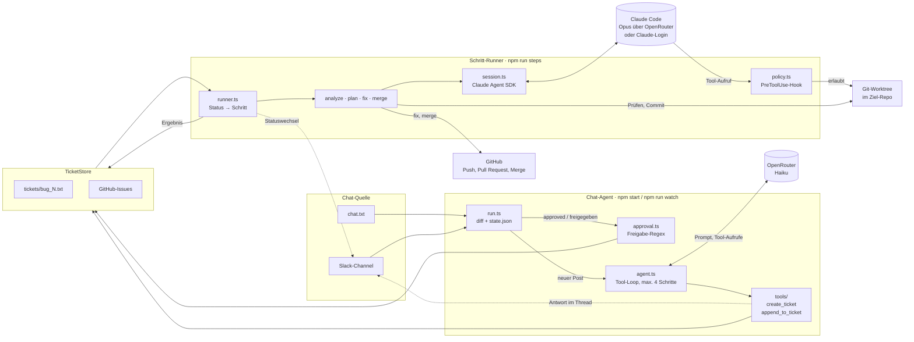
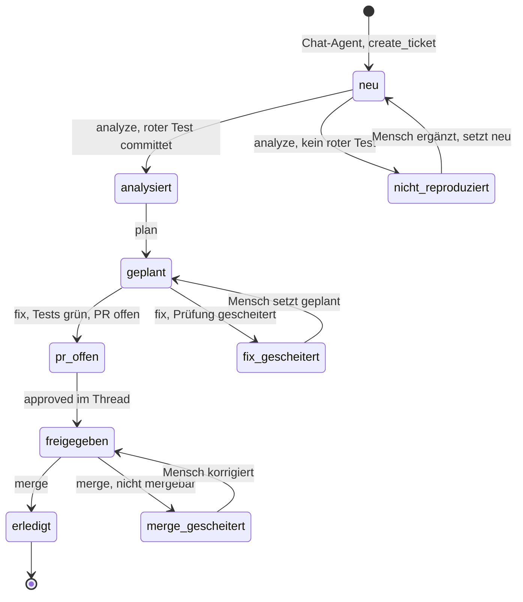
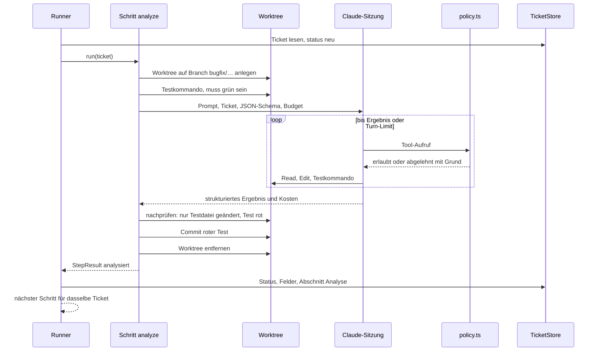

# ai_bugfix_agent

Überwacht `chat.txt` oder einen Slack-Channel, erkennt Bug-Meldungen in Top-Threads und legt dafür Tickets `tickets/bug_N.txt` an. Antworten auf Threads mit Ticket werden dem Ticket als Nachtrag angehängt.

`npm run steps` bringt die Tickets danach voran: Analyse mit rotem Test, Plan, Fix als Pull Request und nach einer Freigabe im Chat den Merge.

## Ein Harness um Sprachmodelle

`ai_bugfix_agent` ist ein Harness. Der Code ruft Sprachmodelle auf, gibt ihnen Werkzeuge und legt alles fest, was um einen Modellaufruf herum geschieht. Die Modelle entscheiden im Einzelfall: Ist dieser Post ein Bug? Wo liegt die Ursache? Welche Zeile muss sich ändern? Der Harness bestimmt, wann ein Modell läuft, was es zu sehen bekommt, welche Werkzeuge es aufrufen darf, wie lange und für wie viel Geld es arbeitet und was mit seinem Ergebnis passiert.

Status, Commit, Push und Merge übernimmt der Harness. Vorher prüft er nach, was das Modell behauptet.

| Aufgabe | Modell | Harness |
| --- | --- | --- |
| Bug erkennen | entscheidet, ob ein Top-Post ein Bug ist; wählt Titel, Komponente, Schweregrad | liefert genau ein Ereignis mit Thread, bietet nur `create_ticket` und `append_to_ticket` an, höchstens 4 Schritte |
| Freigabe | – | erkennt „approved“ oder „freigegeben“ per regulärem Ausdruck (`src/approval.ts`) |
| Analyse | sucht die Ursache, schreibt einen roten Test | legt einen Worktree an, prüft vorher grüne Tests; danach: genau die Testdatei geändert, Tests rot, Testname in der Ausgabe; committet |
| Plan | beschreibt den Fix | gibt nur Lesewerkzeuge; prüft, dass die genannten Dateien existieren |
| Fix | ändert den Code | prüft: Änderungen nur in `TARGET_DIR`, Testdatei unverändert, Tests grün; committet, pusht, öffnet den Pull Request |
| Merge | – | Squash-Merge über die GitHub-API, räumt Branches auf, schließt das Issue |

Leitplanken:

- **Zustandsautomat:** Der Status steht im Ticket. Jeder Schritt nimmt genau einen Status an und liefert ein `StepResult`. Das Ticket schreibt der Runner, nicht der Schritt und nicht das Modell (`src/steps/runner.ts`).
- **Werkzeugrichtlinie:** Jeder Tool-Aufruf einer Sitzung läuft durch einen `PreToolUse`-Hook (`src/steps/policy.ts`). Erlaubt sind Pfade im Worktree und als einziges Shell-Kommando das Testkommando, Zeichen für Zeichen. Alles andere lehnt der Hook ab.
- **Isolation:** Jede Sitzung arbeitet in einem eigenen Git-Worktree. Sie bekommt keine Tokens und lädt keine Einstellungen und kein `CLAUDE.md` aus dem Ziel-Repo (`settingSources: []`). Das ersetzt keine Sandbox, siehe **Sicherheit** unten.
- **Grenzen:** 4 Schritte im Chat-Agenten, 25 bis 40 Turns je Sitzung, `STEPS_MAX_BUDGET_USD` je Sitzung.
- **Strukturierte Ergebnisse:** Sitzungen antworten nach einem JSON-Schema, das aus einem zod-Schema entsteht. Der Harness parst das Ergebnis, bevor er etwas damit tut.
- **Wiederaufsetzen:** Der Chat-Agent speichert seinen Stand nach jedem Ereignis, der Runner hält `steps.lock`. Ein abgebrochener Fix-Lauf holt beim nächsten Mal nur den Pull Request nach.

## Architektur

Zwei Prozesse teilen sich die Tickets. Der Chat-Agent (`npm start`, `npm run watch`) liest den Chat und legt Tickets an. Der Schritt-Runner (`npm run steps`) arbeitet sie ab. Beide kennen die Ablage nur über die Schnittstelle `TicketStore`, Dateien und GitHub-Issues sind austauschbar.



### Ticket-Status

Jeder Pfeil mit Schrittnamen ist ein Schritt des Runners. Die übrigen Übergänge löst ein Mensch aus.



### Ein Schritt im Detail

Am Beispiel der Analyse. Plan und Fix laufen genauso ab, mit anderen Werkzeugen und anderen Prüfungen.



### Wo was liegt

| Pfad | Inhalt |
| --- | --- |
| `src/main.ts`, `src/run.ts` | Einstieg und Lauf des Chat-Agenten |
| `src/diff.ts`, `src/state.ts` | Was ist seit dem letzten Lauf neu |
| `src/agent.ts`, `src/llm.ts`, `src/prompt.md` | Tool-Loop über OpenRouter, Prompt des Chat-Agenten |
| `src/tools/` | Werkzeuge des Chat-Agenten |
| `src/approval.ts` | Freigabe im Chat, ohne LLM |
| `src/sources/` | Chat-Quellen: Datei, Slack |
| `src/store/` | Ticket-Ablage: Dateien, GitHub-Issues |
| `src/steps-main.ts`, `src/steps/runner.ts` | Einstieg und Zustandsautomat des Runners |
| `src/steps/analyze.ts`, `plan.ts`, `fix.ts`, `merge.ts` | Die Schritte mit ihren Prüfungen |
| `src/steps/session.ts`, `policy.ts`, `backend.ts` | Claude-Sitzung, Werkzeugrichtlinie, wer bezahlt |
| `src/steps/prompts/` | Prompts der Sitzungen |

## Chat-Format

```
> Top-Post (startet einen Thread)
>> Antwort
>>> Antwort auf die Antwort
Zeilen ohne Präfix gehören zum vorigen Post.
```

## Start

```bash
npm install
cp .env.example .env   # OPENROUTER_API_KEY eintragen
npm start              # verarbeitet alles Neue und beendet sich
npm run watch          # beobachtet chat.txt dauerhaft (Strg+C beendet)
npm test
```

`npm start -- --watch` funktioniert in PowerShell nicht: PowerShell entfernt das `--`, und npm behält `--watch` für sich.

Der Agent merkt sich in `state.json`, was er schon verarbeitet hat. Löschen von `state.json` und `tickets/` setzt ihn zurück.

Zu jedem Ereignis schreibt der Agent eine Zeile mit seiner Entscheidung und Begründung auf die Konsole und nach `agent.log`, z. B. `Thread 3 → Kein Ticket: Wunsch nach Dark Mode, keine Fehlermeldung.`

Wird ein Top-Post ohne Ticket nachträglich geändert, bewertet der Agent ihn neu. Bei einem Top-Post mit Ticket meldet er die Änderung nur als Warnung.

## Slack

Mit `CHAT_SOURCE=slack` liest der Agent statt `chat.txt` den Channel `SLACK_CHANNEL_ID` und antwortet im Thread einer Meldung, wenn ein Ticket entsteht, wenn er einen Nachtrag anhängt und wenn `npm run steps` den Status ändert. Zu Nachrichten ohne Bug schreibt er nichts.

Einrichtung, einmalig:

1. Einen eigenen, kostenlosen Workspace anlegen, nicht den Firmen-Workspace, darin den Channel `#bugs`.
2. Auf https://api.slack.com/apps „Create New App“ → „From a manifest“, Manifest aus `docs/specs/2026-11-24-slack-quelle-design.md`, Abschnitt „Einrichtung in Slack“.
3. „Basic Information“ → „App-Level Tokens“ → Token mit Scope `connections:write` erzeugen (`xapp-…`).
4. „OAuth & Permissions“ → „Install to Workspace“, Bot-Token kopieren (`xoxb-…`).
5. In `#bugs`: `/invite @bugfix-agent`.
6. Channel-ID aus den Channel-Details ablesen (`C…`).
7. In `.env`: `CHAT_SOURCE=slack`, `SLACK_BOT_TOKEN`, `SLACK_APP_TOKEN`, `SLACK_CHANNEL_ID`.

Danach `npm run watch`. Der Agent merkt sich den Slack-Stand in `state.slack.json`, getrennt von `state.json`. Die Tickets liegen für beide Quellen in `tickets/` und tragen im Kopf `quelle: slack` bzw. `quelle: datei`. Slack-Tickets haben zusätzlich `link:` mit der URL des Threads.

Ist der Agent offline, holt der nächste Start alle Nachrichten nach. Schlägt eine Antwort fehl, steht eine Warnung im Log und der Agent macht weiter. Er wiederholt die Antwort nicht.

## Tickets als GitHub-Issues

Mit `TICKET_STORE=github` legt der Agent Tickets als Issues in `GITHUB_REPO` an statt als Dateien in `tickets/`. `npm run steps` liest dann die Issues und schreibt zurück:

- Status als Label `status:<wert>`, dazu `bugfix-agent`, `komponente:<…>`, `schweregrad:<…>`
- Kopffelder als Tabelle im Body; der Agent pflegt nur den Bereich zwischen `<!-- bugfix-agent:kopf -->` und `<!-- /bugfix-agent:kopf -->`
- Nachträge, Analyse und Plan als Kommentare. Kommentare von Menschen im Issue zählen ebenfalls als Nachtrag.
- Es zählen nur Kommentare von Owner, Mitgliedern und Collaborators des Repos (`author_association`), auch solche mit Markierung. Kommentare anderer GitHub-Nutzer ignoriert der Agent.
- Branch im Ziel-Repo: `bugfix/issue-N`

Den Status setzt ein Mensch zurück, indem er das Label wechselt, z. B. `status:nicht_reproduziert` → `status:neu`. Geschlossene Issues bearbeitet der Runner nicht.

Token: auf GitHub unter Settings → Developer settings → Fine-grained tokens, „Only select repositories“ mit nur diesem Repo, Berechtigung „Issues: Read and write“.

**Achtung:** In einem öffentlichen Repo sind alle Meldungen, Nachträge, Analysen und Pläne öffentlich. Nur mit Testdaten verwenden.

## Erweitern

1. Neues Tool in `src/tools/` mit `defineTool` anlegen.
2. In `src/tools/index.ts` eintragen.
3. Das Verhalten in `src/prompt.md` beschreiben.

## Analysieren und Planen

`npm run steps` bearbeitet die Tickets in `tickets/` mit Sitzungen des Claude Agent SDK im Ziel-Repo `TARGET_REPO`:

- `neu` → `analysiert`: Ursache gefunden, ein roter Test liegt als Commit auf dem lokalen Branch `bugfix/bug-N`.
- `neu` → `nicht_reproduziert`: kein roter Test. Unter `## Analyse` steht, was fehlt. Nach einer Ergänzung `status: neu` setzen, dann versucht es der nächste Lauf erneut.
- `analysiert` → `geplant`: Unter `## Plan` steht der Fix.
- `geplant` → `pr_offen`: Eine Sitzung setzt den Plan um, bis alle Tests grün sind. Der Agent prüft das selbst, committet, pusht `bugfix/issue-N` und öffnet einen Pull Request gegen `TARGET_BASE`. Feld `pr` im Ticket.
- `geplant` → `fix_gescheitert`: Prüfung gescheitert (Testdatei geändert, Änderung außerhalb von `TARGET_DIR`, Tests rot). Unter `## Fix` steht der Grund. Zum Wiederholen den Status auf `geplant` setzen.
- `pr_offen` → `freigegeben`: Jemand schreibt im Slack-Thread genau „approved“ oder „freigegeben“ (ohne Beachtung von Groß- und Kleinschreibung, höchstens mit `!` oder `.`). Das erkennt der Chat-Agent selbst, nicht das LLM. Er antwortet im Thread und vermerkt den Absender im Ticket (`freigegeben_von`).
- `freigegeben` → `erledigt`: Squash-Merge des PRs in `TARGET_BASE`, Branch auf GitHub und lokal gelöscht, Issue geschlossen. Danach `TARGET_BASE` lokal aktualisieren (`git pull`), sonst findet eine neue Analyse behobene Bugs erneut.
- `freigegeben` → `merge_gescheitert`: PR nicht mergebar oder geschlossen. Nach einer Korrektur den Status wieder auf `freigegeben` setzen.

**Achtung:** Die Freigabe prüft nicht, wer sie schreibt. Jeder im Slack-Workspace kann einen Merge auslösen. Nur im eigenen Demo-Workspace verwenden.

Der Fix-Schritt ist nur aktiv, wenn `GITHUB_TOKEN` und `GITHUB_REPO` gesetzt sind. Der Token braucht dann zusätzlich „Contents“ und „Pull requests“ (Read and write). Gepusht wird mit dem Token über Git-Konfiguration aus Umgebungsvariablen, ohne `--force` und nur der Branch des Tickets. Empfehlung: Branch-Protection für `main`.

Mit `TARGET_DIR` arbeiten alle Sitzungen nur in einem Unterordner von `TARGET_REPO`; dort läuft auch das Testkommando. Sitzungen und Testkommandos bekommen keine Tokens und Schlüssel (`GITHUB_TOKEN`, `SLACK_*`, `OPENROUTER_API_KEY`, `ANTHROPIC_*`), außer dem, den Claude Code selbst braucht.

Bei Tickets mit `quelle: slack` erscheint jeder Statuswechsel im Thread der Meldung. Dafür braucht `npm run steps` `SLACK_BOT_TOKEN` und `SLACK_CHANNEL_ID`, aber keinen Socket Mode.

```powershell
npm run steps                       # alle Tickets
$env:TICKET=3; npm run steps        # nur Ticket 3
Remove-Item Env:TICKET
```

Konfiguration in `.env`, siehe `.env.example`. Wer die Sitzungen bezahlt, legt `STEPS_BACKEND` fest:

- `openrouter` (Default): Die Sitzungen laufen über OpenRouter mit `OPENROUTER_API_KEY`, Modell `anthropic/claude-opus-5`. Sie bekommen ein eigenes Claude-Code-Verzeichnis `.claude-steps/` und einen leeren `ANTHROPIC_API_KEY`, sehen also den Claude-Code-Login dieses Rechners nicht. Stimmt der Key nicht, scheitern sie, statt auf den Login auszuweichen. Fehlt der Key, bricht `npm run steps` beim Start ab. In den OpenRouter-Einstellungen Anthropic als bevorzugten Anbieter setzen; nur damit garantiert OpenRouter den Betrieb mit Claude Code.
- `claude-login`: über `ANTHROPIC_API_KEY` oder, ohne Key, den Claude-Code-Login dieses Rechners. Die Sitzungen zählen dann gegen dessen Konto.

Jede Sitzung ist auf `STEPS_MAX_BUDGET_USD` begrenzt. Die Kosten stehen im Ticket unter `kosten_analyse` und `kosten_plan`. Das ist der Preis, den das Agent SDK selbst berechnet. Über OpenRouter lag er im ersten Lauf nah am abgerechneten Betrag (0.35 $ geschätzt, 0.35 $ abgerechnet), verbindlich ist aber die Activity-Seite von OpenRouter.

Das Ziel-Repo muss ohne Installationsschritt testbar sein: Der Worktree enthält kein `node_modules`.

Bricht ein Lauf ab, bleibt eventuell `steps.lock` liegen. Läuft kein anderer Durchgang, die Datei löschen.

**Sicherheit:** Die Sitzungen laufen ohne Sandbox. Beim Analysieren schreibt das Modell einen Test, und der Agent führt ihn aus. Ein Test kann alles, was dein Benutzerkonto darf. Nur mit dem Demo-Repo und Test-Chats verwenden. Für echte Repos müssen die Schritte in einem Container oder unter WSL2 mit aktiver Sandbox laufen, siehe Spec.

### Demo

```powershell
$env:DEMO_TARGET="C:\workspace\tests\bugfix_demo"; npm run demo:init
```

legt das Demo-Repo „Kontaktliste“ mit drei eingebauten Bugs an.

Ist ein Fix in die Vorlage `demo/` gemergt, setzt `npm run demo:reset` sie auf den Stand mit allen drei Bugs zurück (Tag `demo-start`) und committet das. Danach `git push`, damit neue Fixes und Pull Requests vom zurückgesetzten Stand ausgehen. `demo-chat.txt` enthält passende Meldungen und eine, die sich nicht reproduzieren lässt.

Specs: `docs/specs/2026-11-23-analyse-plan-design.md`, `docs/specs/2026-11-24-slack-quelle-design.md`, `docs/specs/2026-11-24-github-issues-design.md`, `docs/specs/2026-11-24-fix-pr-design.md`, `docs/specs/2026-11-24-freigabe-merge-design.md`.
