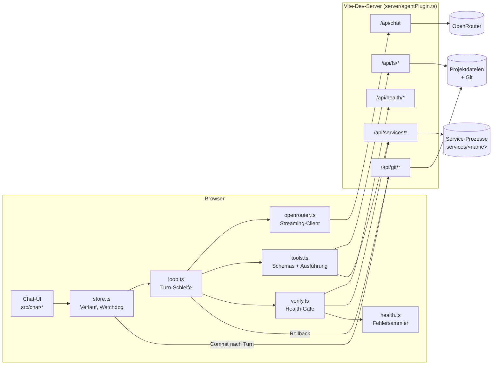
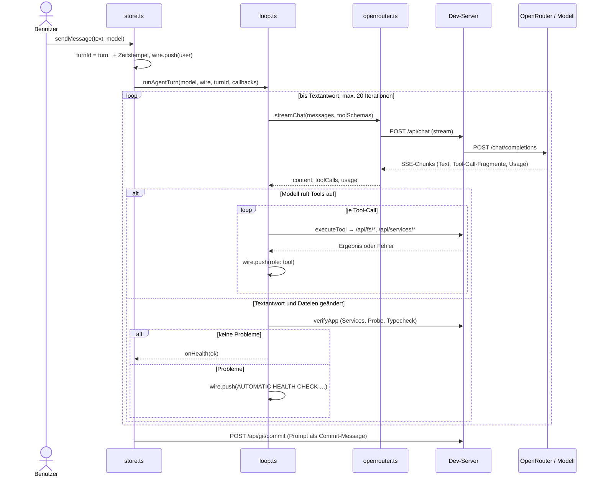
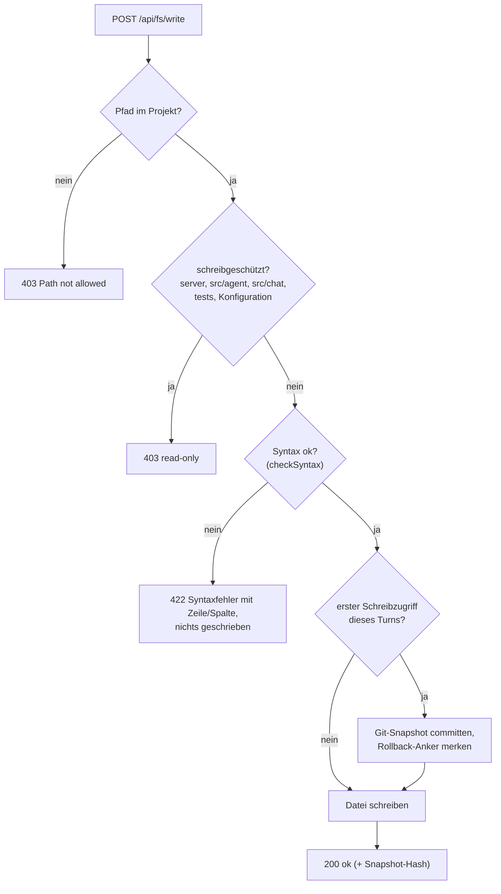
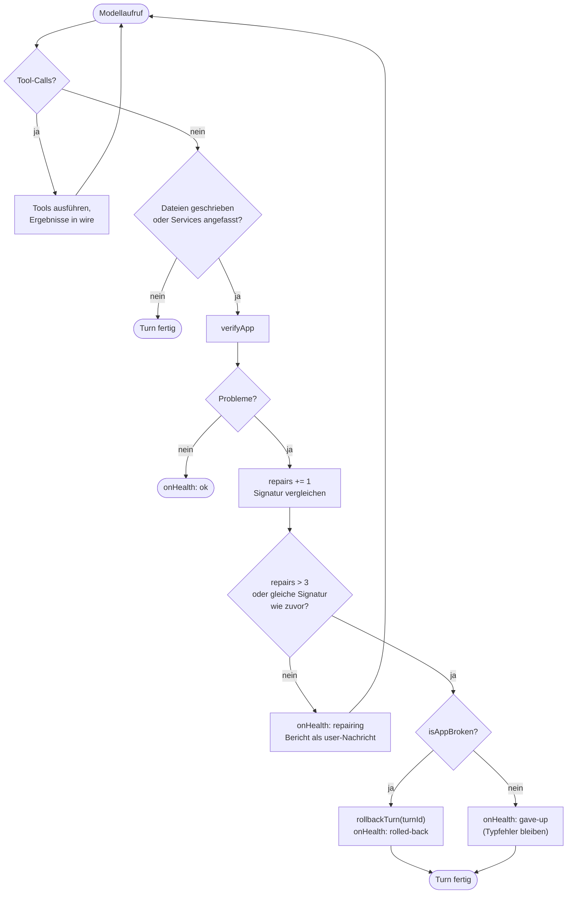
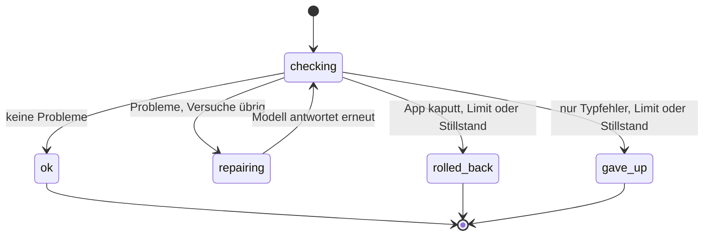
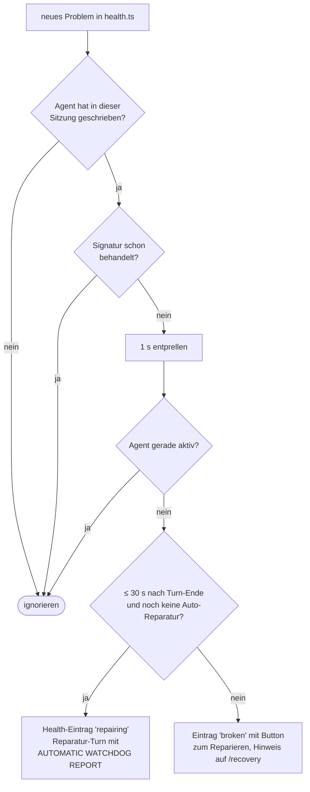

# Der Coding-Agent in `src/agent`

Der eingebaute Coding-Agent von `ai-react` läuft im Browser, ändert über Tools den Quellcode derselben App und prüft danach selbst, ob die App noch funktioniert. Vite lädt jede Änderung per HMR sofort nach.

Stand: 2026-11-06

## Inhalt

1. [Überblick](#überblick)
2. [Dateien und Zuständigkeiten](#dateien-und-zuständigkeiten)
3. [Ein Turn von Anfang bis Ende](#ein-turn-von-anfang-bis-ende)
4. [Modellaufruf und Streaming](#modellaufruf-und-streaming)
5. [Tools](#tools)
6. [Health-Gate nach dem Turn](#health-gate-nach-dem-turn)
7. [Reparatur, Abbruch und Rollback](#reparatur-abbruch-und-rollback)
8. [Watchdog nach dem Turn](#watchdog-nach-dem-turn)
9. [Schutzmechanismen](#schutzmechanismen)
10. [Grenzwerte](#grenzwerte)

## Überblick

Die Agent-Logik liegt im Browser. Der Vite-Dev-Server stellt über das Plugin `server/agentPlugin.ts` eine kleine HTTP-API bereit. Diese API leitet Modellaufrufe an OpenRouter weiter, greift auf das Dateisystem zu, führt Git-Operationen aus und steuert die Backend-Services. Der API-Schlüssel bleibt dadurch auf dem Server.



## Dateien und Zuständigkeiten

| Datei | Aufgabe |
|---|---|
| `loop.ts` | Führt einen Turn aus: Modell aufrufen, Tools ausführen, Ergebnisse zurückgeben, Health-Gate, Reparatur und Rollback. Exportiert `runAgentTurn`. |
| `openrouter.ts` | Schickt einen Chat-Completions-Request an `/api/chat`, liest den SSE-Stream und setzt Text, Tool-Calls und Kosten zusammen. |
| `tools.ts` | Enthält die Tool-Schemas im OpenAI-Format (`toolSchemas`) und `executeTool`, das jeden Tool-Call auf einen API-Endpunkt abbildet. |
| `systemPrompt.ts` | Der Systemprompt: Projektaufbau, Schreibrechte und Regeln für Dateien und Services. |
| `types.ts` | Wire-Format (`ChatMessage`, `ToolCall`) und das UI-Modell des Verlaufs (`TranscriptItem`). |
| `verify.ts` | Health-Gate (`verifyApp`) und Rollback-Aufruf (`rollbackTurn`). |
| `health.ts` | Sammelt Laufzeitfehler im Browser: `window.onerror`, unbehandelte Promises, Vite-HMR-Fehler und React-Renderfehler. Bietet `waitForHmr`. |
| `healthReport.ts` | Reine Funktionen: `isAppBroken`, `signatureOf`, `buildReport`. Ohne Browser- und Server-APIs, daher unit-testbar. |
| `serviceHealth.ts` | Wandelt den Supervisor-Status der Services in `Problem`-Einträge um. Ebenfalls rein. |

Aufgerufen wird der Agent aus `src/chat/store.ts`. Der Store hält zwei Listen: `wire` mit dem Nachrichtenverlauf im OpenAI-Format, der an das Modell geht, und `transcript` mit dem, was die Chat-UI anzeigt. Beide liegen im `localStorage`. `wire` beginnt immer mit dem Systemprompt.

## Ein Turn von Anfang bis Ende

Ein Turn beginnt mit einer Nachricht der Benutzerin oder des Benutzers und endet mit einer Textantwort des Modells, die das Health-Gate bestanden hat. Dazwischen liegen bis zu 20 Modellaufrufe mit Tool-Calls.



`runAgentTurn` verändert `messages` direkt. Jede Assistant-Nachricht und jedes Tool-Ergebnis landet in `wire`, damit das Modell im nächsten Aufruf den ganzen Verlauf sieht. Über die `AgentCallbacks` meldet die Schleife jeden Schritt an den Store, der daraus die Einträge des Verlaufs baut:

| Callback | Wirkung im Verlauf |
|---|---|
| `onAssistantStart` / `onAssistantDelta` / `onAssistantDone` | Assistant-Nachricht anlegen, Text streamen, Streaming beenden |
| `onToolCall` / `onToolResult` | Tool-Karte mit Name und Argumenten anlegen, später Ergebnis eintragen |
| `onHealth` | Health-Eintrag anlegen oder aktualisieren (gleiche `id` je Prüfung) |
| `onTurnUsage` | Kosten und Tokens des Turns anzeigen und zur Sitzungssumme addieren |

Wirft `runAgentTurn` eine Exception, etwa bei einem Fehler von OpenRouter, zeigt der Store sie als Fehlereintrag an. Im `finally` committet der Store in jedem Fall, was der Turn geschrieben hat. Der Server überspringt den Commit, wenn nichts geändert wurde.

## Modellaufruf und Streaming

`streamChat` in `openrouter.ts` sendet diesen Body an `/api/chat`:

```json
{
  "model": "openai/gpt-oss-20b",
  "messages": [ ... ],
  "tools": [ ... ],
  "stream": true,
  "usage": { "include": true },
  "provider": { "ignore": ["Groq"] }
}
```

- `usage.include` lässt OpenRouter Tokens und Kosten im letzten Chunk mitschicken.
- `provider.ignore` schließt Groq aus. Groq prüft Tool-Calls gegen die Liste `tools` und verwirft die ganze Antwort, wenn das Modell ein nicht vorhandenes Tool aufruft (z. B. `search_file` bei gpt-oss-20b). Bei anderen Providern kommt der Aufruf durch, und `executeTool` antwortet mit einer Fehlermeldung samt Liste der vorhandenen Tools. Damit kann das Modell im nächsten Aufruf das richtige Tool wählen.

Der Dev-Server ergänzt den API-Schlüssel und reicht den Body und die Antwort unverändert durch.

Der Client liest die Antwort zeilenweise als Server-Sent Events:

- `delta.content` wird an `content` angehängt und sofort über `onDelta` an die UI gegeben.
- `delta.tool_calls` kommen in Fragmenten. Das erste Fragment eines `index` legt den Tool-Call an, weitere Fragmente hängen Name und Argumente an.
- `usage.cost` und `usage.total_tokens` werden aufsummiert.
- Ein Chunk mit `error` bricht den Stream mit einer Exception ab. So erscheint die Groq-Meldung `Upstream error …` im Chat.

Antwortet der Server ohne `text/event-stream`, wirft `streamChat` einen Fehler mit HTTP-Status und Meldung.

## Tools

Alle Tools führt `executeTool` im Browser aus, indem es den passenden Endpunkt des Dev-Servers aufruft. Das Ergebnis ist immer ein Text plus `isError`. Fehler gehen als `ERROR: …` in die Tool-Nachricht und damit zurück an das Modell.

| Tool | Endpunkt | Zweck |
|---|---|---|
| `list_files` | `GET /api/fs/list` | Alle Dateien und Verzeichnisse des Projekts |
| `read_file` | `POST /api/fs/read` | Inhalt einer Datei |
| `write_file` | `POST /api/fs/write` | Datei vollständig schreiben (mit Syntaxprüfung und Snapshot) |
| `delete_file` | `POST /api/fs/delete` | Datei löschen |
| `create_service` | `POST /api/services/create` | Backend-Service anlegen, Port wird zugewiesen |
| `control_service` | `POST /api/services/control` | Service starten, stoppen, neu starten; `start` wartet auf den Health-Pfad |
| `remove_service` | `POST /api/services/remove` | Service stoppen und löschen |
| `service_status` | `GET /api/services` | Alle Services mit Zustand, Port und URL |
| `service_logs` | `POST /api/services/logs` | Letzte Zeilen von stdout/stderr |

Zwei Fälle fängt `executeTool` vor jedem Netzwerkaufruf ab:

- Ungültiges JSON in den Argumenten liefert `Invalid JSON in tool arguments: …`.
- Ein unbekannter Tool-Name liefert `Unknown tool: <name>. Available tools: list_files, read_file, …`.

Die Schleife merkt sich zwei Dinge für das Health-Gate: die Pfade aller erfolgreichen `write_file`-Aufrufe (`writtenPaths`) und ob ein Tool mit der Endung `_service` erfolgreich lief (`touchedServices`).

### Was der Server bei `write_file` tut



Der Snapshot entsteht einmal pro `turnId`. Ist das Arbeitsverzeichnis sauber, gibt es keinen neuen Commit, und `HEAD` wird zum Rollback-Anker. `delete_file` folgt demselben Ablauf ohne die Syntaxprüfung.

## Health-Gate nach dem Turn

Antwortet das Modell mit Text und ohne Tool-Calls, prüft die Schleife, ob der Turn etwas geändert hat. Hat er weder Dateien geschrieben noch Services angefasst, endet der Turn sofort. Sonst ruft sie `verifyApp` auf.

`verifyApp` wartet zuerst mit `waitForHmr` (höchstens 600 ms), bis Vite die Module ausgetauscht hat. Dann sammelt es Probleme aus vier Quellen, die günstigste zuerst:

| Schritt | Quelle | Problemart |
|---|---|---|
| 0 | `GET /api/services`, ausgewertet von `problemsFromServices` | `service` oder `infra` |
| 1 | `POST /api/health/probe` lädt `src/App.tsx` und alle geschriebenen Module im Dev-Server | `probe` |
| 2 | `errorsSince(turnStartedAt)` aus `health.ts` | `runtime`, `hmr` |
| 3 | `GET /api/health/typecheck` führt den TypeScript-Check aus | `type` |

Ist ein Endpunkt nicht erreichbar, schreibt `verifyApp` nur eine Warnung in die Konsole und meldet kein Problem. Ein Infrastrukturfehler soll keine funktionierenden Änderungen zurückrollen.

`problemsFromServices` überspringt Services, die bereit (`ready`) oder von Hand deaktiviert sind. Ein abgestürzter, hängender oder nicht gestarteter Service ergibt ein Problem. Bei Containern ist die Art `infra`, bei Prozessen `service`.

`health.ts` hört ab dem Laden der Seite auf `error`, `unhandledrejection`, `vite:error` und auf `reportRenderError` aus der `AppErrorBoundary`. Es hält die letzten 20 Einträge mit Zeitstempel. Die Datei liegt im schreibgeschützten Bereich, damit der Agent diesen Rauchmelder nicht abschalten kann.

### Was als „kaputt“ gilt

`isAppBroken` unterscheidet zwei Schweregrade:

- **App kaputt**: mindestens ein Problem der Art `probe`, `runtime`, `hmr` oder `service`. Die App läuft im Browser nicht mehr richtig. Nur dieser Fall kann einen Rollback auslösen.
- **Nur Build kaputt**: ausschließlich `type`- oder `infra`-Probleme. Die App läuft, aber `npm run build` schlägt fehl oder die Umgebung hat ein Problem. In diesem Fall gibt es nie einen Rollback.

## Reparatur, Abbruch und Rollback

Findet das Health-Gate Probleme, baut `buildReport` daraus eine Nachricht, die als `user`-Nachricht in den Verlauf geht. Sie beginnt mit `AUTOMATIC HEALTH CHECK FAILED (repair attempt n of 3)`, listet jedes Problem mit Art, Datei und Position. Am Ende fordert sie das Modell auf, die geänderten Dateien zu lesen und mit `write_file` zu korrigieren. Danach läuft die Schleife weiter, und das Modell bekommt die Gelegenheit zur Reparatur.



`signatureOf` bildet aus Art, Datei, Zeile und Code bzw. Meldung jedes Problems einen sortierten Fingerabdruck. Ist er gleich wie beim letzten Versuch, hat die Reparatur nichts bewirkt. Die Schleife bricht dann sofort ab und gibt keine weiteren Tokens aus.

`rollbackTurn` ruft `POST /api/git/rollback` mit der `turnId` auf. Der Server stellt den Snapshot wieder her, den er vor dem ersten Schreibzugriff dieses Turns angelegt hat.

Die Zustände eines Health-Eintrags im Chat:



Jeder Reparaturversuch bekommt eine eigene ID (`health_<turnId>_<repairs>`) und damit einen eigenen Eintrag im Verlauf.

## Watchdog nach dem Turn

Manche Fehler treten erst auf, wenn jemand die geänderte Seite benutzt. Dafür abonniert `store.ts` über `subscribe` aus `health.ts` jedes neue Problem.



Der Watchdog repariert also höchstens einmal in Folge selbstständig. Danach fragt er nach. Unter `/recovery` lässt sich ein älterer Stand wiederherstellen.

## Schutzmechanismen

Der Agent ändert die App, in der er selbst läuft. Damit er sich dabei nicht lahmlegt, gibt es mehrere Schutzebenen:

| Ebene | Mechanismus |
|---|---|
| Schreibschutz | `server/`, `src/agent/`, `src/chat/`, `tests/`, `index.html`, `src/main.tsx`, `vite.config.ts`, `package.json`, die `tsconfig*.json` sowie `service.json` und `package.json` jedes Service sind schreibgeschützt. Der Server lehnt Schreib- und Löschzugriffe mit 403 ab. |
| Geheimnisse | `.env*` und `package-lock.json` sind auch für `list_files` und `read_file` unsichtbar. |
| Sandbox | `safeResolve` lässt nur Pfade innerhalb des Projekts zu und sperrt `node_modules`, `.git`, `dist`, `.idea` und `.junie`. |
| Syntaxprüfung | `write_file` schreibt nur Dateien, die sich parsen lassen. |
| Snapshot | Vor dem ersten Schreibzugriff eines Turns entsteht ein Git-Commit als Rücksprungpunkt. |
| Health-Gate | Nach jedem ändernden Turn: Services, Modulprobe, Browserfehler, Typecheck. |
| Rollback | Bleibt die App nach drei Versuchen oder bei Stillstand kaputt, wird der Snapshot wiederhergestellt. |
| Watchdog | Fehler nach dem Turn lösen eine einmalige Auto-Reparatur aus, danach eine Rückfrage. |
| Service-Sandbox | Services laufen mit dem Node-Permission-Modell und dürfen nur ihr eigenes Verzeichnis lesen und schreiben. |

## Grenzwerte

| Wert | Ort | Bedeutung |
|---|---|---|
| `MAX_ITERATIONS = 20` | `loop.ts` | Modellaufrufe pro Turn; danach Exception |
| `MAX_REPAIRS = 3` | `loop.ts` | Reparaturversuche nach dem Health-Gate |
| `waitForHmr(600)` | `health.ts` | Wartezeit auf HMR vor der Prüfung in ms |
| `MAX_ENTRIES = 20` | `health.ts` | Gemerkte Browserfehler |
| `AUTO_REPAIR_WINDOW_MS = 30_000` | `store.ts` | Zeitfenster für die automatische Watchdog-Reparatur |
| `DEBOUNCE_MS = 1000` | `store.ts` | Entprellung des Watchdogs |
